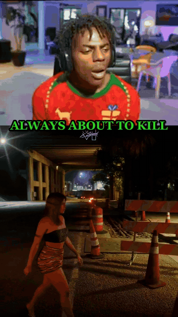

# ClipForge

> Find high-energy moments in live gameplay and render 9:16 clips with word-by-word pop-up captions.

<!-- TODO: Record a 5-10 second demo GIF showing vertical gameplay crop with bouncing pop-up captions and add it here -->


ClipForge is an automated pipeline that finds peak moments in live gameplay streams (such as GTA 6, GTA V, or any action title), smart-crops them into full-screen 9:16 vertical video, burns pop-up animated word captions, and prepares them for YouTube Shorts and Instagram Reels.

---

## ⚡ Quick Start

```bash
# 1. Install dependencies (uv recommended for speed)
uv sync

# 2. Set your YouTube API key (in shell or in a local .env file)
export YOUTUBE_API_KEY="YOUR_KEY"       # Linux / macOS
$env:YOUTUBE_API_KEY="YOUR_KEY"         # Windows PowerShell

# 3. Search streams, capture moments, and auto-title clips
uv run python clipper.py clip
```

---

## 🛠️ How It Works

```
 Live Stream ──> [1. Rolling Capture] ──> [2. Hype Scoring] ──> [3. Smart 9:16 Crop] ──> [4. Pop-up Captions] ──> [5. Output & Social Schedule]
 (yt-dlp)            (ffmpeg)             (Chat + Audio + Whisper)   (Edge Facecam Blocker)   (Animated Word ASS)       (YouTube Shorts / IG Reels)
```

1. **Capture**: Records incoming live stream video in rolling chunks using `ffmpeg` and `yt-dlp`.
2. **Score Moments**: Detects hype peaks using live chat reaction spikes, volume surges (RMS audio), and excited speech keywords via `faster-whisper`.
3. **Crop**: Centers the 9:16 vertical crop on the gameplay and player, clamping framing away from corner facecams (`--block-facecam`).
4. **Caption**: Generates word-level timed transcripts; each word bounces into view in vibrant yellow as it is spoken, while swear words are censored for platform safety.
5. **Export & Publish**: Saves ready-to-post 1080x1920 MP4 files with JSON metadata in `output/`, and optionally schedules them to YouTube Shorts and Instagram Reels via Zernio.

---

## 💻 Prerequisites & OS Support

* **Tested On:** Windows 10/11 and Linux (Ubuntu 22.04+).
* **Python:** 3.10+
* **FFmpeg & FFprobe:** Must be available on your system `PATH`.
* **Node.js:** Required as the JavaScript runtime for `yt-dlp`.

---

## 🚀 Usage

### 1. Find Live Streams (Example: GTA 6)
```bash
# Linux / macOS
python3 find_streams.py "GTA 6" --max 25 --json

# Windows PowerShell
python find_streams.py "GTA 6" --max 25 --json
```

### 2. Capture and Clip Live Stream
Verify that actual gameplay is on screen, then begin capture:
```bash
# Linux / macOS
python3 clip.py "https://www.youtube.com/watch?v=VIDEO_ID" --gameplay-confirmed --clip-len 30 --top 2

# Windows PowerShell
python clip.py "https://www.youtube.com/watch?v=VIDEO_ID" --gameplay-confirmed --clip-len 30 --top 2
```

### 3. Test on a Local Video File
Test the rendering and caption engine on a local gameplay file without network streaming:
```bash
# Linux / macOS
python3 clip.py --file "/path/to/gameplay.mp4" --test --clip-len 30

# Windows PowerShell
python clip.py --file "C:\videos\gameplay.mp4" --test --clip-len 30
```
*(Test output renders to `test_out/` and is marked as test in metadata).*

---

## 📖 Detailed Guides & Documentation

* **[CLI Options Reference](docs/OPTIONS.md)**: Full table of command-line flags (`--moment-source`, `--min-score`, `--layout`, `--block-facecam`, etc.).
* **[Publishing & Scheduling Guide](docs/SCHEDULING.md)**: How to configure Zernio, schedule posts to YouTube and Instagram, and differences between `publish.py` and `zernio_publish.py`.
* **[Multi-Agent Operations](docs/MULTI-AGENT.md)**: Managing multiple streams, checker roles, and channel distribution.
* **[AI Agent Prompt](CLIPPING-PROMPT.txt)**: Ready-to-use prompt to operate ClipForge autonomously with any AI agent.

---

## ⚠️ Rights, Safety & Disclaimer

* **Rights & Permissions:** Recording, clipping, and republishing another creator's livestream requires their explicit permission. Creator credits do not replace license rights.
* **Unattended Posting:** Autonomous or unattended publishing is entirely at the user's own risk. You are solely responsible for compliance with YouTube and Instagram Community Guidelines and Copyright terms.
* **Disclaimer:** ClipForge is an independent fan-made open-source project and is not affiliated with, endorsed by, or sponsored by Rockstar Games, Take-Two Interactive, YouTube, Google, Instagram, Meta, or Zernio.
